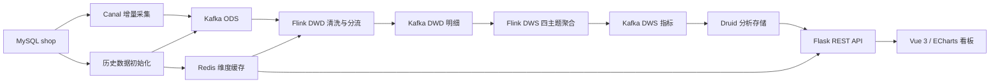

# 基于 Flink + Druid 的电商实时数仓与可视化平台

## 实时链路监控

## 历史基线分析

## 项目介绍

面向电商经营分析场景，构建集实时数据采集、数仓分层计算、分析查询与可视化展示于一体的平台。系统基于电商样例库和模拟增量数据，贯通 MySQL → Canal → Kafka → Flink → Druid → Flask → Vue 3 数据链路，围绕交易、商品、店铺、用户四大主题提供历史分析与实时监控。

## 核心功能

| 业务主题 | 分析功能 |
|---|---|
| 交易分析 | 支付 GMV、下单与支付订单数、分钟趋势、历史交易量价关系 |
| 商品分析 | 支付件数构成、商品排行、销量与成交价值四象限 |
| 店铺分析 | 店铺支付金额排行、交易贡献、历史热力矩阵、分时支付金额 3D 展示 |
| 用户分析 | 用户支付金额排行、支付分布、订单与店铺维度统计 |

看板支持历史基线与实时视图切换、定时刷新、图表交互、加载状态和异常反馈。数据服务提供统一 JSON 响应、参数校验、时间范围筛选与数据质量提示。

## 技术栈

| 层次 | 技术 |
|---|---|
| 数据采集与传输 | MySQL、Canal、Kafka |
| 实时计算与维度关联 | Java、Flink 1.14.6、Redis |
| 分析存储与查询 | Apache Druid |
| 后端服务 | Python、Flask |
| 前端可视化 | Vue 3、ECharts、ECharts GL、Vite |

## 系统架构

## 技术实现

- **数仓分层：** ODS 保留源事件，DWD 完成订单及商品明细清洗、类型与金额校验、商品维度补全和脏数据分流，DWS 按交易、商品、店铺、用户生成分钟级主题指标。
- **状态与事件计算：** 使用订单状态识别首次下单及支付变化，结合 Event Time、Watermark 与滚动窗口计算业务指标，避免普通更新重复触发支付计数。
- **历史与实时衔接：** 通过历史 Bootstrap、Kafka 分区边界和状态预热衔接历史基线与实时增量；结合 Checkpoint、算子 UID 与状态映射处理作业恢复。
- **数据服务：** 按路由、服务、数据访问层组织 Flask 接口，实现字段白名单、参数校验、时间适配、重复记录识别及统一异常响应。
- **前端交互：** 封装指标卡片、趋势图、排行榜和 3D 图表，通过请求取消与响应校验处理视图切换竞态，结合定时刷新展示主题数据。

## 工程结构

| 目录 | 职责 |
|---|---|
| realtime-dw | 历史事实导入 Kafka、维度初始化 Redis |
| realtime-flink-kafka-dwd | 订单与商品明细清洗、维度补全、脏数据处理 |
| realtime-flink-kafka-dws | 四主题历史初始化、状态预热与分钟窗口计算 |
| DataScreen/backend | Flask API、主题查询与指标聚合 |
| DataScreen/frontend | Vue 3 / ECharts 双模式数据看板 |
| DataScreen/tools | 订单及商品明细模拟数据生成 |
| sql | 业务库建表 SQL 与数据字典 |
| docs | 数据模型、运行说明与测试记录 |

## 测试与构建

| 模块 | 逻辑测试 |
|---|---|
| DWD | 39 项通过 |
| DWS | 144 项通过 |
| Flask API | 31 项通过 |
| 前端 | 14 项通过 |

三个 Java 模块完成 Maven 编译打包，前端完成锁定依赖安装与生产构建。测试命令与范围见 [测试记录](docs/verification.md)。

## 项目文档

- [数仓模型与指标口径](docs/data-model.md)
- [部署与运行](docs/deployment.md)
- [看板启动与接口](DataScreen/README.md)
- [业务库表结构](sql/shop-schema.sql)
- [数据字典](sql/data-dictionary.csv)

## License

[Apache License 2.0](LICENSE)
