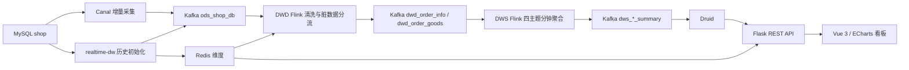

# 基于 Flink + Druid 的电商实时数仓与可视化平台

## 实时链路监控


## 历史基线分析


基于电商样例与模拟增量数据，贯通 MySQL、Canal、Kafka、Flink、Redis、Druid 和前后端看板。包含历史初始化、DWD 清洗、交易/商品/店铺/用户四主题分钟聚合，以及历史基线分析与实时链路监控两个视图。

## 数据链路



Canal 将变更送入 ODS 的部署配置需自行补齐；图中该边描述目标链路，不代表本仓库包含全部基础设施配置。

## 模块

| 目录 | 职责 |
|---|---|
| realtime-dw | MySQL 历史事实写入 Kafka、维度初始化 Redis、连接诊断 |
| realtime-flink-kafka-dwd | orders/order_goods 清洗、商品维度补全、脏数据旁路 |
| realtime-flink-kafka-dws | 四主题历史 Bootstrap、状态预热与分钟窗口聚合 |
| DataScreen/backend | Flask 分层查询服务、参数校验、时间适配和重复记录处理 |
| DataScreen/frontend | Vue3 与 ECharts 图表、双模式切换、刷新和请求竞态保护 |
| DataScreen/tools | MySQL 订单模拟器，默认运行会真实写入 orders/order_goods |
| sql | 84 张表的纯结构 SQL、901 个字段的数据字典；不含原始业务行 |

历史聊天中的另一套 `realtime-dwd/com.shop.dwd` 工程不包含在此仓库，不能将其 19 表通用清洗能力归属于本版本。

## 构建与本地测试

Java 源码目标为 Java 8；Flink 1.14.6 / Scala 2.11。后端建议使用 Python 3.11 并按 requirements 安装（历史 README 的 Python 3.8 与 Flask>=3 要求不一致）。前端沿用 pnpm 锁文件；本次验证环境与结果见 [验证记录](docs/verification.md)。

```powershell
mvn -f realtime-dw/pom.xml package
mvn -f realtime-flink-kafka-dwd/pom.xml package
# DWS离线测试使用 docs/deployment.md 中的明确测试名单命令
cd DataScreen/backend
python -m pip install -r requirements.txt
python -m pytest -p no:cacheprovider tests -q
Copy-Item .env.example .env
# 按本地部署编辑 .env 后启动
python run.py
```

DWS 原 POM 使用 Surefire 2.12.4；明确测试名单见 [部署与运行](docs/deployment.md)，使用脚本生成名单后运行，排除依赖真实Kafka的诊断类。

另一个终端：

```powershell
cd DataScreen/frontend
pnpm install --frozen-lockfile
pnpm test
pnpm run build
pnpm run dev
```

以上测试不会建立完整实时集群。后端健康接口 `GET /api/health` 会真实查询 Druid；前端 `/api` 默认代理本地 5000 端口。

## 配置与复现边界

发布副本将 5 个 Java 文件的明文数据库密码替换为 `MYSQL_PASSWORD` / `REDIS_PASSWORD` 环境变量；在执行端和 Flink TaskManager 所在环境配置。不要将真实值提交到仓库。Kafka、MySQL 地址及用户名仍有源代码默认值，需结合 [部署文档](docs/deployment.md) 修改或配置主机解析。

完整 SQL 转储、Word 测试报告与聊天记录未纳入发布文件。表结构已保留，但仍缺可公开复用的种子数据、正式 Canal 配置及实际 Druid supervisor 导出，详情见 [发布清单](docs/release-checklist.md)。本仓库当前可构建，尚不具备一键复现完整集群的条件。

- [数仓模型与指标口径](docs/data-model.md)
- [合成消息样例](examples/README.md)
- [检查范围与发现](docs/review-findings.md)
- [Apache-2.0 许可证](LICENSE)

本项目为学习与演示工程，不将样例或模拟数据描述为企业生产数据；不声称已验证端到端 Exactly-Once、高可用或生产吞吐量。
