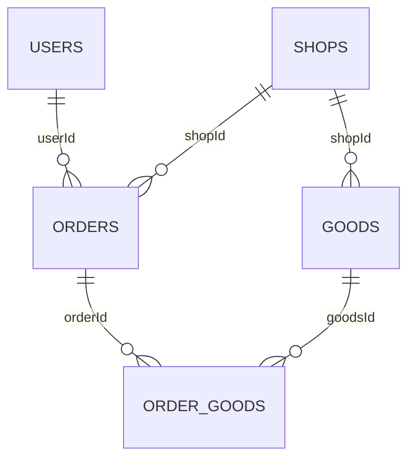

# 数仓模型与指标口径

| 层级 | 数据对象 | 粒度与职责 |
|---|---|---|
| 源库 | shop | 纯结构包含84表901字段，不代表所有表参与实时采集 |
| ODS | ods_shop_db | table/type/data消息；历史FactBootstrap读取orders/order_goods/order_refunds |
| DIM | Redis dim:* | DimBootstrap初始化16类维度/关系表 |
| DWD | dwd_order_info | 订单变更明细，orderId |
| DWD | dwd_order_goods | 商品明细，ogId及orderId/goodsId |
| 异常 | dwd_dirty_data | 清洗失败旁路 |
| DWS | dws_trade_summary | 平台每分钟，orderCount/paidOrderCount/paidAmount |
| DWS | dws_goods_summary | goodsId+分钟，订单数/件数/金额及支付指标 |
| DWS | dws_shop_summary | shopId+分钟，订单/支付/窗口内用户数 |
| DWS | dws_user_summary | userId+分钟，订单/支付/窗口内店铺数 |

DWD生产入口主要处理orders和order_goods；不声称实现全部84表清洗。userId是用户标识，shopId是店铺标识，不把userId视作会员资格。

图表示逻辑关联，不表示数据库有外键约束。

交易的创建事件基于首次订单，支付事件基于首次已支付或未支付到已支付转换，金额取realTotalMoney。普通订单更新不重复产生支付计数。商品指标为明细口径，不能简单视为平台GMV完整拆分。窗口内用户/店铺去重数跨窗口相加不是全周期独立数量。当前逻辑不等于覆盖任意退款、撤销和金额更正的完整财务账本。

窗口为1分钟，Watermark最大乱序5秒。Trade配置迟到侧输出并打印，不能据此声称所有主题都完成迟到补算。

Trade/Shop/User默认历史边界p0=20015，p1/p2=0；商品明细默认边界30638。它们是原环境快照。边界之前仅预热订单状态，Bootstrap负责历史结果。新数据必须重新采集一致边界并对账，不能盲目沿用或重复初始化。

GoodsApp需要goods.runtime.mode=WARMUP或REALTIME，REALTIME需要flink.restore.path恢复预热Checkpoint。新建Job不等于恢复旧状态。

API限定historical=2019年、test=2026年；并非动态年份。Druid历史数据采用“上海钟面标为UTC”约定，TimeAdapter保留钟面附加Z；这是兼容逻辑，不是真正UTC转换。Shop/User事件解析依赖JVM默认时区，部署统一Asia/Shanghai。若修正摄取时区，必须联动迁移存量和API。

API对自然键及指标相同记录去重；同键指标冲突整组排除并返回DATA_CONFLICT。它不修复上游数据，也不等于严格一次写入。
