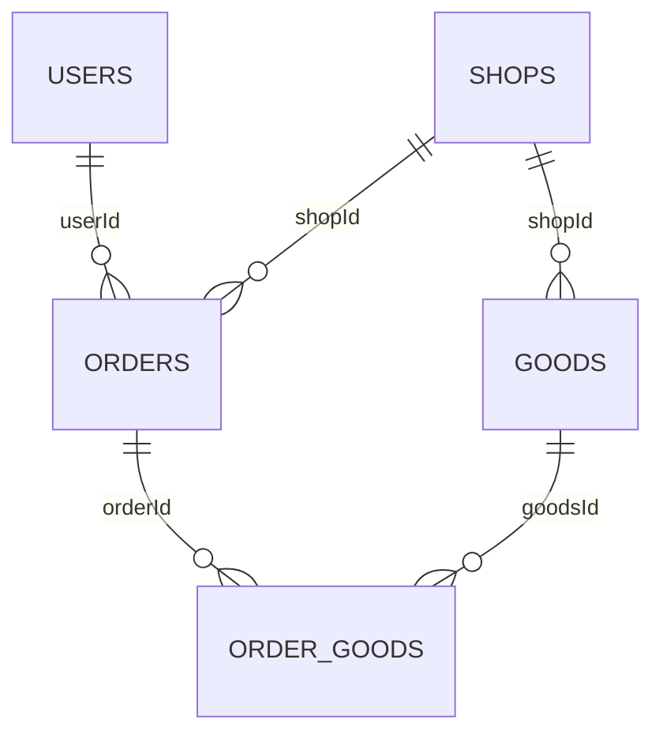

# 数仓模型与指标口径

## 分层设计

| 层级 | 数据对象 | 粒度与职责 |
|---|---|---|
| 业务库 | shop | 业务库表结构与字段定义，详见 sql 目录 |
| ODS | ods_shop_db | table/type/data 原始事件；历史事实包括 orders、order_goods、order_refunds |
| DIM | Redis dim:* | 商品、店铺、用户等维度和关系数据 |
| DWD | dwd_order_info | 按 orderId 组织的订单变更明细 |
| DWD | dwd_order_goods | 按 ogId 组织的商品明细，关联 orderId/goodsId |
| 质量旁路 | dwd_dirty_data | 记录清洗失败事件，便于定位数据问题 |
| DWS | dws_trade_summary | 平台级分钟交易汇总 |
| DWS | dws_goods_summary | goodsId + 分钟汇总 |
| DWS | dws_shop_summary | shopId + 分钟汇总 |
| DWS | dws_user_summary | userId + 分钟汇总 |

## 核心业务关系

userId 标识订单所属用户，shopId 标识店铺，ogId 标识订单商品明细。图中展示业务逻辑关联。

## 指标定义

| 主题 | 指标 | 计算口径 |
|---|---|---|
| 交易 | orderCount | 首次订单创建事件计数 |
| 交易 | paidOrderCount | 首次已支付或未支付到已支付的状态转换计数 |
| 交易 | paidAmount | 支付事件对应的 realTotalMoney |
| 商品 | orderGoodsNum / paidGoodsNum | 商品明细下单件数 / 支付件数 |
| 商品 | orderAmount / paidAmount | 商品明细金额及支付金额 |
| 店铺 | orderUserCount / paidUserCount | 单分钟窗口内下单 / 支付用户去重数 |
| 用户 | orderShopCount / paidShopCount | 单分钟窗口内下单 / 支付店铺去重数 |

商品主题采用明细口径；交易 GMV 采用订单支付金额。用户数与店铺数的去重范围为各自分钟窗口，查询展示按对应粒度解释。

## 事件时间与窗口

下单事件使用 createTime，支付事件使用 payTime。常规计算使用 1 分钟滚动事件时间窗口和 5 秒乱序 Watermark 参数。Trade 通过侧输出记录迟到事件。

历史与实时看板按数据集分别查询：historical 对应 2019 年历史数据，test 对应 2026 年模拟增量数据。

系统使用 Asia/Shanghai 业务时间。现有 Druid 数据以业务钟面对应 __time，API 的 TimeAdapter 统一处理查询与返回时间；部署时统一 JVM 时区，并保持摄取与查询的时间约定一致。

## 历史基线与实时衔接

Bootstrap 汇总历史明细；Trade、Shop、User 通过分区结束位点区分历史预热范围与实时增量范围。位点之前建立订单状态，边界后的事件进入实时指标计算。

GoodsApp 分为 WARMUP 与 REALTIME 阶段：WARMUP 建立订单与明细关联状态，REALTIME 从预热 Checkpoint 恢复。位点与快照配置集中在各主题 BootstrapConfig 中。

## 查询质量处理

服务层按主题自然键组织记录。自然键和指标完全相同的记录保留一条；同键存在指标冲突时，通过 DATA_CONFLICT 提示并隔离该组记录，避免直接累加。店铺名称通过 Redis 维表补充，查询结果保持原始指标值。
